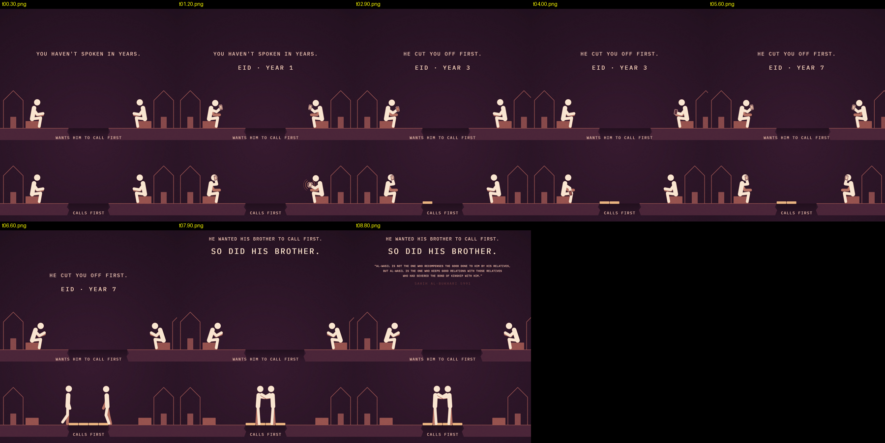

# How these reels are made

*The free course from [@islamicstickreminders](https://www.instagram.com/islamicstickreminders/)*

My top reel has [5.2 million views](https://www.instagram.com/p/DeuW3Q8sP2m/). The page went from 300 followers to 15,000 in one day. This is how I did it.

People sell courses on this. It's too easy to sell. So this one is free. If it helps you, please give to the [New Brunswick Islamic Center's new masjid](https://www.launchgood.com/v4/campaign/a_new_home_for_nbic_secure_the_land_build_the_future). May Allah accept it from you.

One ask. When you post a reel you made with this, put **"Made with the free course from @islamicstickreminders"** in the caption, and send me the reel. I want to see it.

## Getting started

[Download the complete bundle](https://github.com/IslamicStickReminders/stick-figure-reels/archive/refs/heads/main.zip), attach it to Claude and say **Get me started**.
Claude handles the setup. This page is the longer course to read when you
want to understand how the reels work. [The short start page is here](README.md).

The course includes:

- **COURSE.md** — this page
- **[CLAUDE-INSTRUCTIONS.md](CLAUDE-INSTRUCTIONS.md)** — the instructions you give Claude
- **[kit/](kit/)** — the engine: drawing code, fonts, sound, the recitation mixer, 28 recited ayat, worked examples. You never open it; Claude does.
- **example/** — one finished reel ([watch it](example/call-first.mp4)) and its test frames, so you know what "right" looks like

---

## 1. What you need

- A Claude account with code execution and file creation enabled, plus web access to check sources. Claude writes the scene as code, draws every frame, adds the sound, lays in the recitation, and hands you back an mp4 and a caption.
- This repository's link and the instructions file.
- About twenty minutes for a first reel. Most of that is waiting for the render.

You don't need to know how to code. You never touch the code. You describe a feeling, look at test frames, say what's wrong in plain words, and post the result.

---

## 2. Let Claude set it up

Attach the complete downloaded ZIP to a Claude chat and say **Get me started**.
Claude reads the instructions, checks what it can run and prepares the tools.
You don't need to open the files or set up a Project first.

The default is the warm, two-lane story format taught in this course.
The same download also includes infographic reels with matching image cards.
If that's what you want, tell Claude.

For the course format, Claude renders a test frame: a dark plum stage,
white figures and an end card. Once that works, you're ready to give it an idea.
If your Claude setup can't run the tools, it should explain exactly what is
missing and guide you, rather than claim the setup is complete.

Use the same attachment when you start a fresh chat that no longer has the files.

---

## 3. Make a reel

Tell Claude the feeling. In plain words, the way you'd say it to a friend.

- *A reel for someone who can't sleep at 2 AM and scrolls instead of making dhikr.*
- *Someone whose brother stopped speaking to him. He wants the brother to call first.*
- *Someone who got laid off and wants to figure everything out before he trusts Allah with it.*

Then Claude does the rest, in this order:

1. Writes the scene: the two men, the two labels, the rule of the world, the three rounds, the ending line.
2. Finds and verifies the ayah or hadith on quran.com or sunnah.com.
3. Renders test frames and shows you a contact sheet. **Look at it.** This is where you fix things. Say what's wrong the way you'd say it to a person: "the top man should look more tired", "the ending is a scolding, make it gentler", "I can't tell what the bricks are".
4. Renders the full video (a few minutes), adds sound, levels it, and sends you the mp4 with a caption in a code block.

Three habits that save time:

- **One change at a time.** "Change only the end line" keeps Claude from redrawing the whole scene.
- **Ask for the stills again** after a change, before the full render.
- **Read the caption and the reference before you post.** Claude verifies them, but you're the one posting.

---

## 4. What makes one work

This is the part the course sellers don't have. It's not the look. It's the shape.

**Two men, same situation.** Same river, same bricks, same bedroom, same phone. The only thing different is the choice.

**The losing label is a reason you'd defend.** It sounds sincere. "Doesn't want to be a hypocrite." "Wants him to call first." "Needs his sleep for work." "Waiting to mean it." Never a lazy reason like "snooze" or "start tomorrow". The viewer has to see himself in it.

**One man keeps doing the act of worship.** Again and again. He dips five times. He steps on every stone. He climbs again after every fall.

**The other keeps almost doing it and pulling back.** He walks to the edge and backs off. He reaches for the rung and lets go. He picks up the phone and puts it down.

**The world answers the act.** This is the one most people miss. Two men doing two different things is not a reel. In the first few seconds the viewer has to discover a rule: a stone rises under every step; every call lays a plank across the gap; every wash of wudu charges him up a little. Then he watches to see if the other man finds it.

**The ending reveals something that was already true.** Not a bigger version of the contrast. A fact you were looking at the whole time and didn't see.

- "He wanted his brother to call first. / So did his brother."
- "He never fell again. / He never climbed again."
- "He skipped it to recharge. / Only his phone did."
- "He was right every time. / Now he's right by himself."

It reads as irony he can smile at, not a scolding. Write a new ending every time. If you catch yourself writing "he was waiting for X before he'd Y", start over.

**Start from something real.** Every reel starts from something the viewer is living through right now: can't sleep, missing mom's calls, grief, years of unanswered du'a, smiling while falling apart, laid off, a brother who stopped speaking to him. The header names the feeling in plain words. The scene is the feeling made visible.

**One object.** A river. A ladder. A door. A key. A scale. Not masks and phones and meters all at once.

**What doesn't carry it on its own:** two labels, a hadith ending and a dramatic picture. Reels with all three and none of the above don't travel.

---

## 5. The look

The engine does all of this. You don't set any of it. It's here so you know what right looks like when you check the frames.



**Matte and flat-lit.** No glow, no bloom, no neon. This is the mistake every copy makes. Light appears only when it means something in the story: a pool of light under a man, a beam from above. Never as decoration.

**Figures.** Chunky white pictograms, not stick figures. Big round head, no face. Wide capsule torso, long capsule legs. Limbs with round ends.

**Colour.** The frames come out in a warm palette: deep plum background, terracotta props, gold and peach light, white figures. One accent only.

**Type.** A mono typeface, all caps, wide letter-spacing, and small. Much smaller than instinct says. Labels are two to four words. Never a sentence.

**Layout.** Two lanes, one man per lane. The losing man on top, the winner below. The header with the feeling above the scene, a round counter under it (DAY 1 · DAY 7 · DAY 30, or EID · YEAR 1 / 3 / 7). The end card fades in over the top third while the scene keeps running underneath. Never a cut to black.

**Movement.** The figures bend at the hip, the whole upper body as one piece. A move winds up before it goes and settles after it lands. Nothing is ever fully still. Objects are carried and placed, not waved at.

**Length.** About ten seconds. Three rounds, then the end card, which holds for about one second once it's fully up.

---

## 6. What the biggest reels in this genre share

Watch the top ten on any of the big minimalist pages and you'll see the same four things.

**The first second does all the work.** Both labels and both men are on screen in frame one. No title card, no question, no build-up. The viewer knows what he's comparing before he decides whether to stay.

**The headline stays, the sub-label moves.** Two fixed labels on top, and under them a line that changes every round. The comparison holds still while time moves forward.

**The payoff is a re-frame, not an escalation.** The ending doesn't make the gap bigger. It tells you something that was true the whole time. "Same five minutes. Different day."

**Length isn't the lever. The loop is.** Three-second reels and sixteen-second reels both do a hundred million. What they share is that the end state looks like the start state, so it loops without a seam and people watch it four times without noticing.

---

## 7. Religious content rules

Claude is told all of this. You're still the one posting.

- Every Qur'an reference checked on quran.com, every hadith on sunnah.com. Exact surah and ayah, exact collection and number. Nothing from memory.
- Qur'an or sahih hadith only. Hasan is acceptable with the grade shown. If a solid source can't be found, there's no reel.
- A Qur'an end card plays the recitation of just the relevant words. A hadith end card plays no recitation.
- Never draw a prophet, Maryam or Hajar. Never show du'a or sujood toward the sun.
- Never put a commended act in the losing lane. A man who prays taraweeh is never the one who loses.
- Never preachy. The picture makes the point. The end card confirms it.

---

## 8. Captions

Every reel ships with one. Second person throughout, never "I".

```
<a question that names the feeling>

<two or three short lines that open it up>

The Prophet ﷺ said: "<exact verified text>"
(<Collection and number>)
    or: Allah says: "<translation>" (Qur'an S:A)

Ask yourself:
<question>
<question>
<question>

Send this to <someone specific>.

Follow for more.

Made with the free course from @islamicstickreminders

#<topic> #<topic> #islamicreminders #muslim #deen
```

---

## 9. If something goes wrong

- **Claude says it can't run code or make files.** Check that your Claude setup supports those features and has them enabled.
- **The render fails.** Say: *Run the smoke test again.* If it fails again, start a new chat and clone again.
- **It can't fetch a recitation.** Twenty-eight common ayat are already in the kit. For any other ayah, download the mp3 from everyayah.com (reciter: Mishary Alafasy, 128kbps; the file is named by surah and ayah, so 17:23 is 017023.mp3) and attach it to the chat. Or use a hadith end card instead.
- **The Arabic looks broken.** Tell Claude to write the ayah without the dagger alif.
- **The video is over 10 MB.** Tell Claude to re-encode it under 10 MB.

---

That's the whole thing. Make one. Then send it to me.

---

<sub>Copyright (c) 2026 Islamic Stick Reminders for the course material and original code. Fonts in the kit: Amiri, IBM Plex Mono and Space Mono, each under the SIL Open Font License (see kit/fonts). Recitations: Mishary Rashid Alafasy, via everyayah.com. The code in the kit is yours to use for your own reels.</sub>

Third-party source credits and licence scope: [THIRD-PARTY-NOTICES.md](THIRD-PARTY-NOTICES.md).
